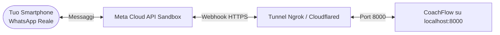

# Guida per la Creazione di un Ambiente di Test 🧪

Questa guida ti accompagna passo dopo passo nella configurazione e nell'utilizzo di un **ambiente di test completo per CoachFlow**.

Puoi testare il sistema in due modalità:
1. **Modalità 1: 100% Locale / Mock (Zero Credenziali Esterne):** per testare la Dashboard, le rotte API, il database e la logica di prenotazione senza bisogno di account Meta, OpenAI o Google.
2. **Modalità 2: Test su WhatsApp Reale (Meta Sandbox + Tunnel HTTPS):** per interagire direttamente dal tuo smartphone con il bot su WhatsApp, scambiando messaggi, bottoni interattivi e note vocali.

---

## 📋 Indice dei Contenuti
- [Modalità 1: Ambiente di Test Locale (Mock Mode)](#modalità-1-ambiente-di-test-locale-mock-mode)
  - [1.1 Configurazione dell'Ambiente](#11-configurazione-dellambiente)
  - [1.2 Avvio del Server](#12-avvio-del-server)
  - [1.3 Simulazione Webhook WhatsApp tramite cURL](#13-simulazione-webhook-whatsapp-tramite-curl)
- [Modalità 2: Test su WhatsApp Reale dal tuo Smartphone](#modalità-2-test-su-whatsapp-reale-dal-tuo-smartphone)
  - [2.1 Ottenere il Numero di Sandbox Gratuito da Meta](#21-ottenere-il-numero-di-sandbox-gratuito-da-meta)
  - [2.2 Creare il Tunnel HTTPS (Ngrok o Cloudflared)](#22-creare-il-tunnel-https-ngrok-o-cloudflared)
  - [2.3 Configurare il Webhook su Meta Developers](#23-configurare-il-webhook-su-meta-developers)
  - [2.4 Testare la Chat dal Telefono](#24-testare-la-chat-dal-telefono)
- [Modalità 3: Test con Docker Compose (Simulazione Produzione)](#modalità-3-test-con-docker-compose-simulazione-produzione)
- [Esecuzione della Test Suite Automatica](#esecuzione-della-test-suite-automatica)

---

## 💻 Modalità 1: Ambiente di Test Locale (Mock Mode)

In questa modalità non serve alcuna chiave API esterna:
- Il calendario usa **`MockCalendarProvider`** (in-memory, simula le risposte di Google Calendar).
- L'AI può usare **`MockAIProvider`** (risposte predefinite a costo zero) o **OpenAI/Gemini** se hai una chiave API personale.
- Il database usa **SQLite asincrono locale** (`aiosqlite`).

### 1.1 Configurazione dell'Ambiente

Crea un file `.env.test` o modifica direttamente il tuo `.env`:

```bash
cp .env.example .env
```

Compila il file `.env` con queste impostazioni:

```ini
# Applicazione
ENVIRONMENT=test
PORT=8000
DEBUG=True

# Database locale SQLite
DATABASE_URL="sqlite+aiosqlite:///./coach_flow_test.db"

# Personal Trainer
PT_NAME="Coach Marco"
PT_PHONE_NUMBER="+393330001122"
CALENDAR_PROVIDER="mock"  # google | mock
DEFAULT_VOICE_MEMO_URL="https://example.com/audio/sample_voice_memo.ogg"

# Motore AI (se vuoi testare senza spendere token usa 'mock', altrimenti 'openai')
AI_PROVIDER="mock"        # mock | openai | gemini
OPENAI_API_KEY=""
GEMINI_API_KEY=""
AI_MODEL_NAME="gpt-4o-mini"

# Meta WhatsApp (disabilitando il segreto la firma HMAC non viene richiesta per i test locali)
META_WA_PHONE_NUMBER_ID="mock_phone_number_id"
META_WA_ACCESS_TOKEN=""
META_WA_VERIFY_TOKEN="mio_token_segreto_test_123"
META_WA_APP_SECRET=""     # Lascia vuoto per disattivare la verifica della firma HMAC in locale
```

---

### 1.2 Avvio del Server

Attiva l'ambiente virtuale e lancia FastAPI con hot-reload:

```bash
source .venv/bin/activate
uvicorn coach_flow.main:app --reload --port 8000
```

Il server sarà accessibile su `http://localhost:8000`:
- **Dashboard Web del Coach:** [http://localhost:8000/dashboard](http://localhost:8000/dashboard)
- **Gestione Orari e Turni:** [http://localhost:8000/dashboard/working-hours](http://localhost:8000/dashboard/working-hours)
- **Calendario & Appuntamenti:** [http://localhost:8000/dashboard/calendar](http://localhost:8000/dashboard/calendar)
- **Atleti & Lead:** [http://localhost:8000/dashboard/clients](http://localhost:8000/dashboard/clients)
- **Swagger UI Interattivo:** [http://localhost:8000/docs](http://localhost:8000/docs)

---

### 1.3 Simulazione Webhook WhatsApp tramite cURL

Puoi simulare l'arrivo di messaggi e click di bottoni interattivi inviando richieste HTTP all'endpoint del webhook locale.

#### A. Simula un messaggio di testo in ingresso da un cliente:
```bash
curl -X POST http://localhost:8000/whatsapp/webhook \
  -H "Content-Type: application/json" \
  -d '{
    "object": "whatsapp_business_account",
    "entry": [{
      "id": "123456789",
      "changes": [{
        "value": {
          "messaging_product": "whatsapp",
          "metadata": {"phone_number_id": "mock_id"},
          "messages": [{
            "id": "wamid_test_1",
            "from": "393339998877",
            "timestamp": "1710000000",
            "type": "text",
            "text": {"body": "Ciao, vorrei prenotare una seduta giovedì"}
          }]
        },
        "field": "messages"
      }]
    }]
  }'
```

#### B. Simula il click sul bottone interattivo "Confermo ✅":
```bash
curl -X POST http://localhost:8000/whatsapp/webhook \
  -H "Content-Type: application/json" \
  -d '{
    "object": "whatsapp_business_account",
    "entry": [{
      "id": "123456789",
      "changes": [{
        "value": {
          "messaging_product": "whatsapp",
          "metadata": {"phone_number_id": "mock_id"},
          "messages": [{
            "id": "wamid_btn_1",
            "from": "393339998877",
            "timestamp": "1710000000",
            "type": "interactive",
            "interactive": {
              "type": "button_reply",
              "button_reply": {
                "id": "confirm_app_test_1",
                "title": "Confermo ✅"
              }
            }
          }]
        },
        "field": "messages"
      }]
    }]
  }'
```

#### C. Simula l'invio del Discovery Outreach con Nota Vocale:
```bash
curl -X POST http://localhost:8000/discovery/outreach \
  -H "Content-Type: application/json" \
  -d '{
    "name": "Alessandro Neri",
    "phone_number": "+393401234567",
    "fitness_goals": "Rimettersi in forma e perdere 5kg",
    "medical_notes": "Nessuna patologia",
    "pt_name": "Coach Marco"
  }'
```

---

## 📱 Modalità 2: Test su WhatsApp Reale dal tuo Smartphone

Questa modalità ti consente di chattare direttamente dal tuo smartphone con il numero di test ufficiale di Meta.



### 2.1 Ottenere il Numero di Sandbox Gratuito da Meta
1. Accedi a [developers.facebook.com](https://developers.facebook.com/) con il tuo account Facebook.
2. Vai su **Le mie App** ➡️ **Crea App** ➡️ Scegli la tipologia **Business**.
3. Nella dashboard dell'app, scorri fino a **WhatsApp** e clicca su **Imposta**.
4. Vai nella sezione **WhatsApp ➡️ Guida introduttiva (API Setup)**:
   - Troverai un **Numero di telefono di prova** (es. `+1 555 0...`) e il relativo **ID del numero di telefono** (`Phone Number ID`).
   - Troverai un **Token di accesso temporaneo (valido 24 ore)**.
5. Nel campo **"A" (Destinatario)**: clicca su *Gestisci elenco numeri di telefono* e aggiungi il **tuo numero di telefono personale**. Riceverai un codice via WhatsApp per verificare il tuo numero.

---

### 2.2 Creare il Tunnel HTTPS (Ngrok o Cloudflared)

Meta richiede obbligatoriamente che il Webhook sia servito su un indirizzo **HTTPS pubblico** e valido.

Se hai **ngrok** installato (installabile da [ngrok.com](https://ngrok.com/)):
```bash
ngrok http 8000
```
Ngrok ti mostrerà un URL pubblico sicuro, ad esempio:
`https://a1b2-c3d4.ngrok-free.app`

*(In alternativa puoi usare `cloudflared tunnel --url http://localhost:8000` o `localtunnel`).*

---

### 2.3 Configurare il Webhook su Meta Developers

1. Nella barra laterale di Meta Developers, vai su **WhatsApp ➡️ Configurazione**.
2. Nel riquadro **Webhook**, clicca su **Modifica**:
   - **URL di callback:** inserisci l'URL di ngrok seguito da `/whatsapp/webhook`, es:
     ```
     https://a1b2-c3d4.ngrok-free.app/whatsapp/webhook
     ```
   - **Verifica token:** inserisci lo stesso valore impostato in `META_WA_VERIFY_TOKEN` nel tuo file `.env` (es. `mio_token_segreto_test_123`).
3. Clicca su **Verifica e salva**:
   - Meta invierà una richiesta `GET` al tuo server locale; il router risponderà con il challenge e l'indicatore diventerà verde ✅.
4. Clicca su **Gestisci campi webhook** e attiva la sottoscrizione alla casella **`messages`**.

---

### 2.4 Aggiornare il file `.env` e Testare dal Telefono

Aggiorna il tuo `.env`:
```ini
META_WA_PHONE_NUMBER_ID="INSERISCI_ID_NUMERO_DA_META"
META_WA_ACCESS_TOKEN="INSERISCI_TOKEN_TEMPORANEO_META"
META_WA_VERIFY_TOKEN="mio_token_segreto_test_123"
META_WA_APP_SECRET="" # Mantieni vuoto in sandbox

AI_PROVIDER="openai" # oppure "gemini" per risposte intelligenti reali
OPENAI_API_KEY="sk-..."
```

**Fatto!**
Ora apri WhatsApp dal tuo smartphone e invia un messaggio di testo al **numero di prova di Meta**.
- L'agente CoachFlow risponderà al tuo smartphone in tempo reale!
- Potrai chiedergli disponibilità, prenotare slot, testare il pulsante rapido e visualizzare le sessioni registrate sulla tua Dashboard locale su [http://localhost:8000/dashboard](http://localhost:8000/dashboard).

---

## 🐳 Modalità 3: Test con Docker Compose (Simulazione Produzione)

Se vuoi testare l'intera architettura containerizzata con **PostgreSQL 16 reale** e il container dell'app ultra-slim:

```bash
# 1. Avvia lo stack in background
docker compose up -d --build

# 2. Controlla che i container siano avviati e sani (healthy)
docker compose ps

# 3. Segui i log del backend in tempo reale
docker compose logs -f app
```

L'API e la Dashboard saranno disponibili sulla porta 8000:
- Dashboard: `http://localhost:8000/dashboard`
- Healthcheck: `http://localhost:8000/health`

Per fermare l'ambiente di test Docker:
```bash
docker compose down
```

---

## 🧪 Esecuzione della Test Suite Automatica

Per verificare che tutte le componenti (modelli, calendario, HMAC, WhatsApp, AI e Dashboard) funzionino all'unisono prima di fare deploy:

```bash
# Esegui tutti i 59 test unitari e di integrazione
pytest -v

# Esegui il controllo qualità del codice con Ruff
ruff check .
```
Risultato atteso: **59 passed, 0 errors**.
