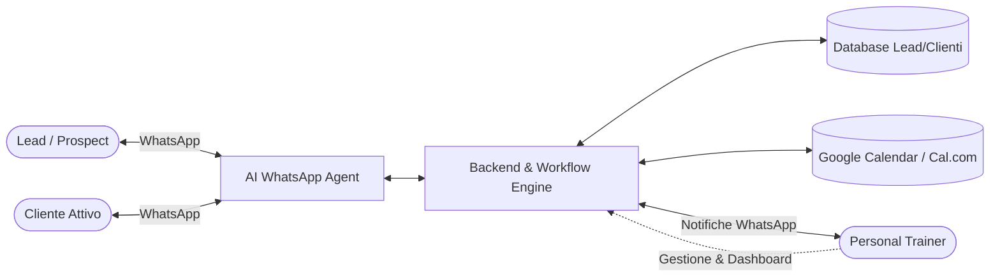

# Specifiche di Progetto: AI Personal Trainer Assistant (WhatsApp Booking & Retention)

---

## 1. Visione d'Insieme & Obiettivi

Il progetto mira a realizzare un assistente virtuale AI integrato con **WhatsApp** per automatizzare il ciclo di vita degli appuntamenti di un **Personal Trainer (PT)**, massimizzando il tasso di conversione dei prospect e azzerando i no-show dei clienti attivi.

### Obiettivi Principali:
1. **Outreach & Discovery:** Contattare nuovi lead con un primo contatto personalizzato (testo + nota vocale standard/autentica).
2. **Conversational Booking:** Gestire la negoziazione di date e orari via chat e fissare l'appuntamento direttamente nel calendario del trainer.
3. **Riduzione No-Show (Conferme Interattive):** Inviare promemoria interattivi con bottoni (Conferma / Riprogramma / Disdici).
4. **Promemoria Operativi per il Trainer:** Notifiche real-time al trainer prima di ogni sessione e recap dell'agenda giornaliera.
5. **Human Handover:** Passaggio trasparente del controllo al PT umano in caso di richieste complesse, dubbi clinici/fisici o personalizzazioni particolari.

---

## 2. Attori e Canali



1. **Lead / Prospect:** Utente che ha lasciato i propri contatti (es. da IG, referral, landing page).
2. **Cliente Attivo:** Atleta con pacchetto attivo o appuntamenti ricorrenti.
3. **Personal Trainer (PT):** Proprietario del servizio, riceve notifiche, definisce la disponibilità e interviene quando richiesto.
4. **AI Agent:** Agente conversazionale che interpreta il linguaggio naturale, verifica gli slot e aggiorna lo stato su WhatsApp.

---

## 3. Flussi Funzionali Dettagliati

### Flusso A: Discovery & Outreach Nuovi Lead
1. **Trigger:** Il PT inserisce un lead (o viene ricevuto da webhook/form/foglio Excel con Nome, Telefono, Obiettivo principale).
2. **Invio Iniziale (Template WhatsApp pre-approvato):**
   - **Testo personalizzato:** Generato o completato con variabili: es. *"Ciao [Nome]! Sono [Nome PT], ho visto la tua richiesta per tornare in forma. Ti andrebbe di fare una consulenza conoscitiva e prima valutazione gratuita in studio/online?"*
   - **Messaggio Audio Standard:** Invio di un file audio (OGG/Opus simulato come nota vocale) registrato dal PT una sola volta (*"Ciao! Ho appena visto il messaggio, ti lascio questo vocale rapido..."*). Questo crea un impatto empatico altissimo rispetto a un semplice bot testuale.
3. **Apertura Sessione 24h:** Quando il lead risponde al messaggio o all'audio, si apre la sessione di messaggistica bidirezionale libera (Meta 24-hour service window).

---

### Flusso B: Conversazione & Booking Autonomo
1. **Ascolto e Riconoscimento Intenti:**
   - Domande informative (dove ti alleni, tariffe generali, disponibilità).
   - Preferenze di orario (*"preferisco i pomeriggi verso le 18:00"*, *"solo martedì e giovedì mattina"*).
2. **Verifica Disponibilità (Function Calling):**
   - L'AI interroga le API del calendario del PT (es. Google Calendar, Calendly o Cal.com).
   - Esclude slot già occupati, orari di riposo e buffer necessari tra una sessione e l'altra (es. 15 min di pausa).
3. **Proposta & Chiusura:**
   - L'AI propone 2 opzioni concrete: *"Perfetto! Ho libero questo giovedì alle 18:30 oppure venerdì alle 17:30. Quale preferisci?"*
   - Una volta confermata la scelta:
     - Crea l'evento su Google Calendar.
     - Invia un riepilogo al lead via WhatsApp con i dettagli (luogo/link, abbigliamento consigliato, orario).
     - Invia una notifica istantanea al PT (*"Nuovo appuntamento fissato con Marco Rossi per Giovedì 18:30"*).

---

### Flusso C: Promemoria & Conferma Interattiva (Anti No-Show)
1. **Schedulazione Promemoria:**
   - **T - 24 ore:** Messaggio interattivo con bottoni rapidi WhatsApp:
     - `[ Confermo ✅ ]`
     - `[ Sposta data 🔄 ]`
     - `[ Annulla ❌ ]`
   - **T - 2 ore:** Promemoria finale di promemoria (*"Ci vediamo tra due ore in studio!"* con indicazioni su mappa o note).
2. **Gestione Risposte Interattive:**
   - **Se "Confermo":** Lo stato dell'evento viene marcato come `Confermato` nel database/calendario. Notifica silenziosa al PT.
   - **Se "Sposta data":** L'AI risponde immediatamente aprendo la negoziazione per un nuovo slot, liberando il vecchio orario.
   - **Se "Annulla":** L'evento viene cancellato, lo slot torna libero per altri clienti e il PT riceve un alert immediato.

---

### Flusso D: Promemoria e Assistenza al Personal Trainer
1. **Daily Digest (es. ore 07:30 o sera prima):**
   - Messaggio WhatsApp inviato al PT con la lista delle sessioni previste per la giornata, stato di conferma dei clienti e note speciali (es. infortuni, obiettivi della scheda).
2. **Alert Pre-Sessione (T - 30 min):**
   - Promemoria: *"Prossima sessione: Luca Bianchi alle 15:00. Focus: Gambe / Scheda B."*
3. **Human Handover / Alert Operativi:**
   - Se il bot rileva sentiment negativo, domande fuori perimetro o esplicita richiesta di parlare col PT (*"Vorrei parlare direttamente con lui"*), il bot risponde: *"Certamente! Ho avvisato subito [Nome PT], ti risponderà qui a breve!"* e invia una notifica d'emergenza al PT con link diretto per subentrare nella chat.

---

## 4. Architettura Tecnica Consigliata

```mermaid
graph TB
    subgraph WhatsApp Ecosystem
        WA[Meta WhatsApp Cloud API]
    end

    subgraph Core Backend
        API[API Gateway / Webhook Handler (FastAPI o NestJS)]
        Orchestrator[Workflow & Dialog Orchestrator]
        Scheduler[Scheduler & Queue (BullMQ / Celery / Cron)]
    end

    subgraph Intelligence & Services
        LLM[LLM Agent (Gemini / OpenAI) + Tool Calling]
        CalService[Calendar Service (Google Calendar API)]
        AudioStorage[Audio Assets (S3 / Cloud Storage)]
    end

    subgraph Data Layer
        DB[(PostgreSQL / Supabase)]
    end

    WA <-->|Webhooks & Messages| API
    API <--> Orchestrator
    Orchestrator <--> LLM
    Orchestrator <--> CalService
    Orchestrator <--> DB
    Scheduler -->|Trigger Memo| Orchestrator
    Orchestrator -->|Send Audio/Template| WA
    AudioStorage -.-> WA
```

### Componenti Chiave:
1. **WhatsApp Provider:**
   - **Meta WhatsApp Cloud API (Ufficiale)** tramite un Business Solution Provider (o account diretto Meta Developer / Twilio / 360dialog).
   - *Nota fondamentale:* Evitare librerie non ufficiali (web scraping come Baileys/whatsapp-web.js) per numeri business primari onde evitare il ban del numero telefonico.
2. **Backend & Job Queue:**
   - **Linguaggio/Framework:** Python (FastAPI) oppure TypeScript (Node.js/NestJS).
   - **Queue/Scheduler:** Redis + BullMQ (o Celery) per gestire l'invio programmato di messaggi (T-24h, T-2h, Daily Digest) e il rate-limiting.
3. **Motore AI (LLM & Function Calling):**
   - **System Prompt:** Definisce personalità (professionale, amichevole, conciso, orientato all'azione).
   - **Tools/Funzioni esposte:**
     - `get_available_slots(start_date, end_date)`
     - `book_appointment(customer_id, slot_time, notes)`
     - `reschedule_appointment(appointment_id, new_slot_time)`
     - `cancel_appointment(appointment_id, reason)`
     - `escalate_to_human(reason)`
4. **Integrazione Calendario:**
   - Integrazione diretta con **Google Calendar API** (due vie: lettura busy/free e scrittura eventi) o **Cal.com API** (che offre già gestione buffer, orari di lavoro e link di riprogrammazione).
5. **Database (es. Supabase / PostgreSQL):**
   - Tabelle: `trainers`, `clients`, `leads`, `conversations`, `messages`, `appointments`, `reminders`.

---

## 5. Vincoli Regolamentari & WhatsApp Business Policy

> [!WARNING] Regole Meta per le comunicazioni Outbound
> WhatsApp non permette a un'azienda di inviare messaggi a testo libero verso un utente che non ha scritto nelle ultime 24 ore.

1. **Messaggi Template Pre-Approvati:**
   - Il primo messaggio di discovery e i promemoria T-24h devono essere registrati come **Message Template** (categoria: *Marketing* per il primo contatto, *Utility* per i promemoria appuntamenti).
   - Il messaggio vocale standard può essere inviato contestualmente come media message o subito dopo la risposta.
2. **Opt-in & GDPR:**
   - Raccogliere sempre il consenso del lead (es. checkbox su form di contatto: *"Acconsento a essere contattato su WhatsApp per informazioni sui percorsi"*).
   - Meccanismo di opt-out rapido (es. *"Rispondi STOP se non vuoi più ricevere messaggi"*).

---

## 6. Piano di Rilascio / Roadmap Suggerita

1. **Fase 1: Configurazione Canale & Calendario (Fondamenta)**
   - Creazione account WhatsApp Business Cloud API & Meta Business Manager.
   - Sincronizzazione con Google Calendar per lettura disponibilità.
2. **Fase 2: AI Booking Agent (Inbound & Discovery)**
   - Implementazione webhook per ricezione messaggi.
   - Agente LLM con tool calling per fissare appuntamenti.
   - Invio audio vocale standard di benvenuto.
3. **Fase 3: Scheduler Promemoria & Anti No-Show**
   - Job programmato per T-24h (con bottoni interattivi) e T-2h.
   - Digest giornaliero per il Personal Trainer.
4. **Fase 4: Mini Dashboard PT (Opzionale)**
   - Semplice interfaccia web per visualizzare lead, stato conversazioni e attivare o disattivare l'AI per singoli contatti.
